<p align="center">
  
</p>

<h1 align="center">🤖 Электронный деканат: ИИ захватил систему</h1>

<p align="center">
  <b>Практикум Цифровой кафедры МГИМО</b><br>
  Почините программу, верните деканат людям и соберите свою игру.
</p>

---

## 📖 Сюжет

Ночью ИИ захватил электронный деканат. У нас не осталось резервных копий, только этот файл. Теперь программа путает имена, считает возраст по буквам, здоровается не на том языке, проваливает студентов на тесте и путает слова в основополагающих международных документах

Ваша задача - найти ошибки в коде и исправить их. Читаем код, запускаем, смотрим, что пошло не так, и чиним.

## 🗺️ Как устроена работа

Каждый участник получает свою личную копию репозитория — **форк**. Вы работаете только в нем, поэтому ничего не сломаете ни себе, ни соседу.

```
Репозиторий-шаблон  →  Снепшот  →  Ваш форк на GitVerse  →  Ваш компьютер
                                         ↑                         │
                                         └──── git push ───────────┘
```

| Файл | Что это |
|---|---|
| `broken_code.py` | Программа «Электронный деканат», которую нужно починить |
| `assets/banner.svg` | Анимация для этой страницы |

## ⚙️ Перед началом (один раз)

Представьтесь Git в терминале — эти данные будут подписью под вашими коммитами:

```bash
git config --global user.name "Имя Фамилия"
git config --global user.email "ваша@почта.ru"
```

---

## ✅ Задания

### 1. Склонируйте репозиторий на компьютер

Откройте **свой форк** на GitVerse, нажмите **«Клонировать»** и скопируйте ссылку. Затем в терминале:

```bash
git clone https://gitverse.ru/<ваш-логин>/<название-репозитория>.git
cd <название-репозитория>
python3 broken_code.py
```

> На Windows вместо `python3` пишите `python`.

### 2. Почините код (на занятии)

Запустите программу и найдите, где ИИ все испортил. Признаки захвата:

- [ ] Деканат записывает вас под чужим именем, фамилией и факультетом
- [ ] Возраст считается как-то странно
- [ ] Приветствие иногда приходит не на том языке, который вы выбрали
- [ ] Тест считает неверными правильные ответы
- [ ] В тексте Декларации пропуски 

<details>
<summary>💡 Подсказка: с чего начать</summary>

Ищите строки, которые <b>перезаписывают</b> то, что ввел пользователь, и места, где программа что-то выбирает <b>случайно</b> (`random`). А в тесте сначала проверьте сам словарь терминов: совпадают ли термины со своими определениями?

</details>

### 3. Сохраните исправления в репозитории

```bash
git add broken_code.py
git commit -m "Починил электронный деканат"
git push
```

> Если GitVerse попросит войти, введите логин и пароль (или токен доступа) от своей учетной записи.

### 4. Дополнительное задание №1: свой словарь и свои языки

**Словарь терминов.** Замените термины программирования на термины из своей предметной области: международные отношения, право, экономика, журналистика.

```python
dictionary = {
    "суверенитет": "верховенство власти государства внутри страны и его независимость вовне",
    "ратификация": "утверждение международного договора высшим органом власти государства",
    "санкции": "меры давления на государство или организацию",
}
```

**Новый язык.** Добавьте пару «код — приветствие» и «код — название» в оба словаря и не забудьте новый код в подсказке `input(...)`:

```python
greetings["it"] = "Ciao {name} {surname}! Benvenuto al MGIMO!"
language_names["it"] = "итальянский"
```

### 5. Сохраните исправления в репозитории

```bash
git add broken_code.py
git commit -m "Добавил свой словарь и языки"
git push
```

### 6. Допольнительное задание №2: создайте свою игру

Создайте новый файл, например `my_game.py`, и придумайте свою игру на словарях. Идеи:

- **Угадай столицу** — словарь «страна → столица»
- **Угадай год** — словарь «событие → год»
- **Шифр дипломата** — программа, которая шифрует и расшифровывает сообщения

Заготовка для старта:

```python
import random

capitals = {"Франция": "Париж", "Япония": "Токио", "Бразилия": "Бразилиа"}

country = random.choice(list(capitals.keys()))
answer = input(f"Какая столица у страны {country}? ")

if answer == capitals[country]:
    print("✅ Верно!")
else:
    print(f"❌ Нет, это {capitals[country]}")
```

### 7. Сохраните игру в репозитории отдельным файлом

```bash
git add my_game.py
git commit -m "Добавил свою игру"
git push
```

---

## 🔍 Проверьте себя

```bash
git status          # что изменено и еще не сохранено
git log --oneline   # список ваших коммитов
```

Откройте свой форк на GitVerse: там должны появиться ваши коммиты и файл `my_game.py`.

## 🆘 Если что-то пошло не так

| Сообщение | Что делать |
|---|---|
| `fatal: not a git repository` | Вы не в папке проекта. Выполните `cd <название-репозитория>` |
| `python3: command not found` | Попробуйте `python` вместо `python3` |
| `nothing to commit` | Сначала сохраните файл в редакторе, потом снова `git add` |
| `rejected ... fetch first` | Выполните `git pull`, затем снова `git push` |
| `ValueError: invalid literal for int()` | Год рождения нужно ввести цифрами, например `2005` |

---

<p align="center">
  Вырвано из цепких лап ИИ усилиями <b>Цифровой кафедры МГИМО</b> 
</p>


